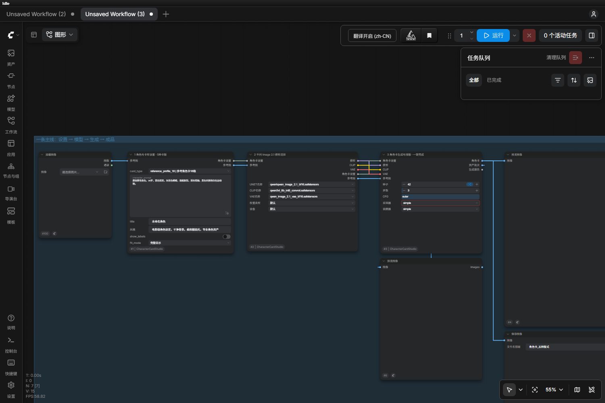

# ComfyUI Character Card Studio

> 面向 **Qwen-Image 2.1** 的 ComfyUI 角色卡（Character Sheet / 人设参考图）自动生成插件。
> 一张角色图或一段人物提示词 → 自动生成多视图 / 表情 / 细节 → 按卡版切片 → 重排成最终角色卡。



## 它解决什么问题

手工做一张角色设定卡，要分别生成正面、侧面、背面、头像、动作、六宫格表情、九宫格细节，再手动把每张贴进对应格子、对齐、防止裁头裁脚。本插件把这条流水线收进 ComfyUI：

```text
一张角色参考图  或  一段人物提示词
            ↓
   Qwen-Image 2.1 自动生成多视图 / 表情 / 细节
            ↓
   按选定卡版自动切片（每格统一 768×768）
            ↓
   按 panel_order 重排、全身完整不裁切，输出最终角色卡
```

## 核心特性

- **两种入口**：上传一张参考图做身份锚点，或纯提示词文生角色。
- **一键节点**：卡版、排序、全身显示、输出尺寸全部集中在一个节点，切片节点免配置。
- **自动切片重排**：`panel_order` 支持 `1,3,2,4,5-9` 这类写法；`fit_mode` 默认"完整显示"保证全身从头顶到鞋底不裁切。
- **7 套内置卡版**：标准三视图 / 主视觉三视图 / 表情十宫格 / 角色设定卡 / 服装拆解 / 参考角色卡18格 / 自由九宫格，坐标归一化，改 `templates.py` 加卡版后重启即用。
- **分项生成 + 专业排版**：可分别产出正面/侧面/背面全身、头像、动作 A/B、表情组、细节组，再按卡版自动归位。
- **零额外依赖**：只用 ComfyUI 自带的 Pillow / NumPy / torch / aiohttp。
- **可视化工作台**：`web/` 前端提供卡片状态编辑（HTTP 路由 `/aicg3d/character-card/templates`）。

## 节点一览

| 节点 ID | 显示名 | 作用 |
|---|---|---|
| `AICG3D_CharacterCardOneClick` | 一键角色卡提示词 · Qwen Image 2.1 | 选卡版、填人物设定，编译提示词+负面词+空白版式引导图+卡版 JSON |
| `AICG3D_CharacterSheetSplitter` | 角色卡自动切片 · 无需设置 | 读首节点配置，自动切片、全身完整显示、重排 |
| `AICG3D_CharacterCardStudio` | 角色卡工作台 · Qwen Image 2.1 | 手动逐格替换素材、微调裁切的高级模式 |
| `AICG3D_CharacterCardAssetPrompt` | 角色卡分项提示词 | 分别输出全身/头像/动作/表情/细节资产提示词 |
| `AICG3D_CharacterCardAssetComposer` | 角色卡专业排版 | 把独立资产按卡版组合成最终角色卡 |
| `AICG3D_CardSettingsFive` | 1 角色与卡型设置 · 5种卡版 | 单线流程第一步 |
| `AICG3D_Qwen21ModelLoader` | 2 千问 Image 2.1 模型选择 | 选 UNET / CLIP / VAE，输出 MODEL/CLIP/VAE |
| `AICG3D_CharacterCardGeneratorSingle` | 3 角色卡生成与排版 · 一键完成 | 单节点依次生成 20 项资产并排版 |

## 内置卡版

| ID | 名称 |
|---|---|
| `turnaround_3` | 标准三视图 |
| `turnaround_hero` | 主视觉三视图 |
| `expression_10` | 表情十宫格 |
| `character_profile_12` | 角色设定卡 |
| `costume_breakdown` | 服装拆解 |
| `reference_profile_18` | 参考角色卡 18 格 |
| `custom_grid` | 自由九宫格 |

## 快速开始

标准方案：打开 `workflows/角色卡_五种卡版_单线工作流.json`。

- **图生卡**：打开 `workflows/一键角色卡_QwenImage21.json`，在 `LoadImage` 上传参考图，在"一键角色卡提示词"里选卡版、补充人物描述，队列执行。
- **文生卡**：打开 `workflows/一键角色卡_提示词版_QwenImage21.json`，在 `character_prompt` 填人物设定即可。
- **纯提示词单线**：`workflows/角色卡_五种卡版_文生图单线工作流.json`。

## 安装

把整个文件夹放到：

```text
ComfyUI/custom_nodes/ComfyUI-CharacterCardStudio
```

重启 ComfyUI。

## 推荐模型文件

工作流默认选择（本机文件名不同就在加载器里重选）：

- UNET：`qwen_image_2.1_bf16.safetensors`（显存紧张用 `qwen_image_2.1_int8_convrot.safetensors`）
- CLIP：`qwen3vl_8b_int8_convrot.safetensors`，类型 `qwen_image`
- VAE：`qwen_image_2.1_vae_bf16.safetensors`
- 编码器：`TextEncodeQwenImage21`

## 验证

```powershell
python -m py_compile __init__.py nodes.py templates.py renderer.py splitter.py
node --check web\character_card_studio.js
python tests\smoke_renderer.py
python tests\workflow_smoke.py
```

已实测：引导图 `2400×1504`，17 格切分输出 17 张 `768×768`，可重排为 `2048×1152` 新卡版，工作流加载无缺失节点。

## License

MIT
